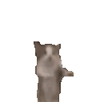
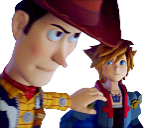
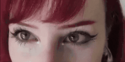

<h1 align="center">Ax Forge</h1>

<b>English</b> · <a href="#espanol">Español</a>

Camera, no-shake and skin mods for Marvel Rivals — all in one app.

  
  

<h2> What it does</h2>

- **Per-hero camera:** move each hero's camera closer or farther (FOV) and build the mod.
- **No shake:** removes camera shake from impacts, shots and abilities.
- **Default skin:** put any game skin (or a skin mod) on a hero's default skin.
- **Repair mods:** checks mods made for another game version and removes what would make them crash.
- **After every patch:** one button rebuilds everything from the new game files.

Your game files are **never modified**: everything is installed as separate mods.

<h2> How to install</h2>

1. Go to **[Releases → latest version](../../releases/latest)** and download the `.exe` (under *Assets*).
2. Open it. If Windows shows “Windows protected your PC”, click **More info → Run anyway** (this happens with any program without a digital signature).
3. Done: it finds the game by itself and already includes everything it needs. After that it updates itself.

<h2> Support me</h2>

If it helps you, following me is what helps me the most:

  &nbsp;&nbsp;
  &nbsp;&nbsp;
  

Fan project, not affiliated with NetEase or Marvel. Use mods at your own risk.

  

---

 

<h1 align="center">Ax Forja</h1>

<a href="#english">English</a> · <b>Español</b>

Mods de cámara, sin temblor y skins para Marvel Rivals — todo en una sola app.

  
  

<h2> Qué hace</h2>

- **Cámara por personaje:** aleja o acerca la cámara de cada héroe (FOV) y genera el mod.
- **Sin temblor:** quita el temblor de cámara de impactos, disparos y habilidades.
- **Skin por defecto:** pon cualquier skin del juego (o un mod de skin) en la skin por defecto de un personaje.
- **Reparar mods:** revisa mods de otra versión del juego y quita lo que los haría crashear.
- **Tras cada parche:** un botón rehace todo con los archivos nuevos del juego.

Tus archivos del juego **no se modifican**: todo se instala como mods aparte.

<h2> Cómo instalar</h2>

1. Ve a **[Releases → la última versión](../../releases/latest)** y descarga el `.exe` (en *Assets*).
2. Ábrelo. Si Windows muestra «Windows protegió su PC», toca **Más información → Ejecutar de todas formas** (pasa con cualquier programa sin firma digital).
3. Listo: detecta el juego sola y ya trae todo lo necesario. Después se actualiza sola.

<h2> Apóyame</h2>

Si te sirve, lo que más me ayuda es que me sigas:

  &nbsp;&nbsp;
  &nbsp;&nbsp;
  

Proyecto de fans, no afiliado a NetEase ni a Marvel. Usa los mods bajo tu propio riesgo.
